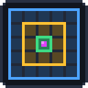

# ChunkHelper

A small client-side Fabric mod for Minecraft **26.3** that shows which chunks an **ender pearl** or a **player** at a given position would keep loaded. Use it when you build pearl stasis chambers, chunk loaders or AFK spots, so you know which chunks around a point really tick.

The outline is drawn in the world in the style of the F3+G chunk borders: three nested squares on the chunk borders, one per load state, plus a beam and a label on the exact point.

## Usage

```
/ch <x> <z> pearl     show the chunks an ender pearl at this position loads
/ch <x> <z> player    show the chunks a player at this position loads
/ch clear             remove the outline
/ch                   short usage hint
```

`/chunkhelper` works the same as `/ch`.

- `<x> <z>` are **block coordinates**. `~` is relative to you, so `/ch ~ ~ pearl` uses your current position and `/ch ~10 ~ pearl` a point 10 blocks east.
- The point stays **fixed** where you set it. It does not follow you around.
- There is **one point at a time**: a new `/ch` command replaces the previous one.
- The outline only shows in the **dimension** where you set it, and it is removed when you leave the world or server.

After each command, the chat shows the chunk position and the size of every zone, for example:

```
[ChunkHelper] Ender pearl at -38 120 (chunk -3 7)
  ■ entity ticking 1x1   ■ block ticking 3x3   ■ loaded 5x5
```

## What the colors mean

| Color | Zone | What runs there |
|---|---|---|
| 🟩 Green | Entity ticking | Everything: entities, mob AI, random ticks (crops, ...), redstone |
| 🟨 Yellow | Block ticking | Redstone, scheduled block ticks and block entities. Entities are frozen and no random ticks happen |
| 🟦 Blue | Loaded (inactive) | The chunk is loaded and accessible, but nothing ticks |

Each zone includes the zones inside it. For example, the blue square also contains the yellow and green ones.

## How the sizes are calculated

Chunks are loaded through *tickets*. A ticket gives its chunk a *level*, and the level goes up by 1 per chunk outwards (square / chessboard distance). Level 31 or lower means entity ticking, 32 means block ticking and 33 means loaded but inactive.

**Ender pearl**
A pearl puts one ticket with radius 2 (level 31) on the chunk it is in:

| Zone | Size |
|---|---|
| Entity ticking | 1×1 (only the pearl's chunk) |
| Block ticking | 3×3 |
| Loaded | 5×5 |

**Player**
A player gets two kinds of tickets:

- a *loading* ticket (level 31) on every chunk within the server's **view distance**
- a *simulation* ticket on its own chunk at level `31 - simulation distance`

Entities only tick where both reach level 31, so the zones are:

| Zone | Radius in chunks | Example: view 12, simulation 10 |
|---|---|---|
| Entity ticking | `min(view, simulation)` | 21×21 |
| Block ticking | `min(view, simulation) + 1` | 23×23 |
| Loaded | `view + 2` | 29×29 |

The mod uses the view and simulation distance the **server** sends to the client, not your own video settings. In singleplayer, these are your render distance and simulation distance.

> **Note:** This is a preview of what a pearl or player *would* load at that point, based on the vanilla rules. It does not check whether those chunks are loaded right now.

## Installation

Requirements:

- Minecraft 26.3
- Fabric Loader 0.19.5 or newer
- Fabric API (0.165.2+26.3)
- Java 25

Put the mod jar and Fabric API into your `mods` folder. The mod is **client-side only**, so it works on any server without being installed there.

## Building from source

```bash
./gradlew build
```

The jar ends up in `build/libs/chunkhelper-<version>.jar`.

To start a development client with the mod loaded:

```bash
./gradlew runClient
```

## Project structure

```
src/client/java/de/jlosch/chunkhelper/
├── client/
│   ├── ChunkhelperClient.java      entrypoint: registers the command and the render hook
│   ├── ChunkHelperCommand.java     /ch and /chunkhelper
│   ├── LoadPreview.java            the current point and the zone sizes
│   └── ChunkOutlineRenderer.java   draws the outlines (vanilla gizmos)
└── mixin/client/
    └── ClientPacketListenerAccessor.java   reads the server view / simulation distance
```

## License

All rights reserved. See [LICENSE.txt](LICENSE.txt).
